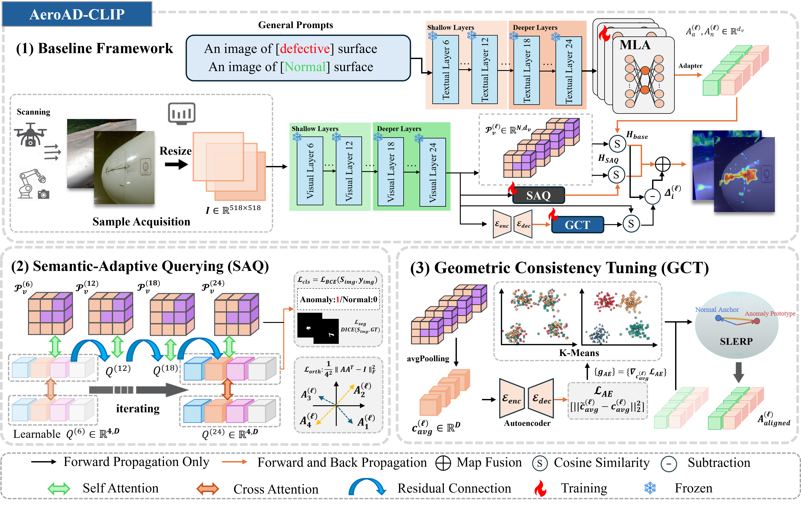

# AeroAD-CLIP

Official code release for **AeroAD-CLIP: A Semantics–Geometry Synergized Framework for Zero-Shot Aircraft Skin Defect Detection** (IEEE Transactions on Aerospace and Electronic Systems, under review).

AeroAD-CLIP detects aircraft skin defects **without any aircraft-specific training data**. The CLIP backbone is frozen; only three lightweight parts are trained, all on public industrial anomaly-detection data (MVTec AD / VisA):

- **MLA — Multi-Layer Adapter**: two MLP projectors that map the CLIP text anchors ("normal" / "anomalous") into the visual feature space of every selected ViT layer (6, 12, 18, 24).
- **SAQ — Semantic-Adaptive Querying**: four learnable queries that are propagated layer by layer through self- and cross-attention, so that the discriminative direction is conditioned both on the image and on the depth of the layer.
- **GCT — Geometric Consistency Tuning**: a bottleneck autoencoder trained on normal images only, whose reconstruction gradients are clustered into anomaly-manifold prototypes; the normal anchor is rotated toward these prototypes on the unit sphere (SLERP), and a patch is only accepted when several prototypes agree.

This repository contains the source code of the three modules, the checkpoints of **all trainable parts**, and the pre-computed **anomaly-manifold prototypes** in HDF5 format.

  

  <em>Overview of AeroAD-CLIP. (1) Frozen CLIP backbone with the Multi-Layer Adapter (MLA) that maps text anchors into the visual space of layers 6/12/18/24; (2) Semantic-Adaptive Querying (SAQ), where four learnable queries are propagated across layers by self- and cross-attention; (3) Geometric Consistency Tuning (GCT), where reconstruction-gradient prototypes steer the normal anchor on the unit sphere by SLERP and the per-patch deviations are combined by consistency voting.</em>

---

## 1. What is included

| Component | Code | Weights | Status |
|---|---|---|---|
| Multi-Layer Adapters (MLA) | `models/mla.py` | `checkpoints/mvtec_ad/MLA/adapters_{6,12,18,24}.pth` `checkpoints/visa/MLA/adapters_{6,12,18,24}.pth` | **released** |
| Semantic-Adaptive Querying (SAQ) | `models/saq.py` | `checkpoints/*/SAQ/*.pth` — **Release asset** | weights shipped in `saq_checkpoints.zip` (≈ 385 MB each, above GitHub's 100 MB file limit) |
| GCT bottleneck autoencoder | `models/gct_autoencoder.py` | `checkpoints/*/GCT/*.pth` — **Release asset** | weights shipped with the same release |
| Anomaly-manifold prototypes (GCT) | `models/gct_tuning.py` | `manifold/anomaly_manifold.h5` — **Release asset** | in preparation |
| Fusion / scoring heads | `models/scoring.py` | — | no trainable parameters |

**Not included**

- **CLIP ViT-L/14-336 weights.** Download `ViT-L/14-336px` from the official OpenAI CLIP release and place it so that `clip.load('ViT-L/14-336px')` can find it. The backbone is frozen in our pipeline and is never fine-tuned.
- The industrial benchmarks (MVTec AD, VisA, BTAD, MPDD, DAGM, KolektorSDD, KolektorSDD2). Please obtain them from their original sources and follow their licenses.
- The aircraft-skin benchmark.
